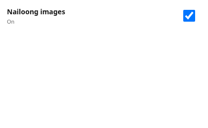

# Nailoong Image Swap

A Chrome Manifest V3 extension that replaces the images on every website you
visit with Nailoong images.


Every image is pulled from a live Bing image search at runtime. There is no
bundled image pack and no hardcoded URL list, so the pictures you get change
between page loads.

- **Off by default.** Nothing happens until you flip the switch in the toolbar popup.
- **Nothing is bundled.** The whole extension is about 40 KB unpacked, 7.5 KB zipped.
- **No account, no telemetry, no analytics.** The only network calls are the image search and the image downloads.
- **GPL-3.0-or-later.**

Other languages: [繁體中文](README.zh-Hant.md) · [简体中文](README.zh-Hans.md)

---

## Install

You do not need Node, npm, or any developer dependencies. You need the built
`dist/nailoong-image-swap` folder.

1. Get the project (`git clone`, or download and unzip a release).

2. Open the extensions page in Chrome, Brave, Edge, or another Chromium browser:

```text
chrome://extensions
```

Use `brave://extensions` for Brave, or `edge://extensions` for Edge.

3. Turn on **Developer mode** (top right).

4. Click **Load unpacked**.

5. Select the `dist/nailoong-image-swap` folder.

6. Click the **Nailoong Image Swap** toolbar icon and turn on the **Nailoong images** switch.

7. Reload the site you want to test.

> If you have the source rather than a built `dist/`, run `npm install && npm run build` in the project root first, then load `dist/nailoong-image-swap`.

## Usage

Click the toolbar icon to get a single switch:



Turn it on and images start swapping on the current page and every page after
it. Turn it off and the original images come back. The setting is stored in the
browser and survives restarts.

## How it works

The content script walks the page and replaces `` elements and CSS
background images. It never fetches anything itself: it asks the background
service worker for a numbered slot, and the worker decides what image to send
back.

The worker keeps a pool of image URLs from Bing image search. When the pool runs
low it picks a random query and a random results page and refills it. Each page
load therefore draws from a different slice of the results.

Images are converted to `data:` URLs before they reach the page, so the page
never sees a remote image host.

## Development

```bash
npm install
npm run build
```

The build compiles `src/` into `dist/nailoong-image-swap/` and produces
`dist/nailoong-image-swap.zip`. Everything under `dist/` is generated; never
edit it by hand. After a rebuild, click the reload button on the extension card.

Other commands:

```bash
npm run typecheck   # TypeScript type check
npm run build:dev   # dev build that keeps the localhost test hook
```

## Project layout

```text
src/
  background.ts      service worker: search, fetch, cache, hand out images
  content.ts         content script: scan the page, swap, restore
  search-images.ts   Bing image search and result parsing
  messages.ts        message shapes and validation between the two sides
  popup.ts           toolbar popup switch logic
  popup.html/css     popup UI
  types/chrome.d.ts  the Chrome API typings this project uses
scripts/build.mjs    the only build script
manifest.json        extension config, copied into dist/ at build time
assets/demo/         screenshots used by the READMEs
README.md            this file (English)
README.zh-Hant.md    Traditional Chinese
README.zh-Hans.md    Simplified Chinese
```

## Notes

- Images come from Bing's search thumbnails, so they are not high resolution. They get soft when stretched across a full-width image.
- The worker only fetches thumbnails from Bing's own CDN (`ts1`-`ts4.mm.bing.net`). Search results pointing anywhere else are dropped.
- Each page load picks a random query and a random results page, so different sites and different times show different images.
- If an image fails to load, the worker walks forward to the next one rather than leaving a broken image.
- Parses Bing's search endpoint, not an official API. If Bing changes it, swapping stops.

## Security

The content script runs on every page, so it treats the page as hostile.

- It only ever writes `data:image/...` values back into the DOM, and only for raster formats. SVG is excluded because it can carry script.
- It rejects messages that do not come from this extension.
- It never names a URL. It asks for a numbered slot, and the worker decides what to fetch, so a hostile page cannot steer a request at a host of its choosing.
- The worker only fetches thumbnails from Bing's own CDN and drops any search result pointing elsewhere.
- The localhost test hook is compiled out of release builds; only `npm run build:dev` includes it.

## Permissions

| Permission | Why |
| --- | --- |
| `storage` | Remembers whether the switch is on. |
| `host_permissions` for `www.bing.com/images/async` | Runs the image search. |
| `host_permissions` for `ts1`-`ts4.mm.bing.net` | Downloads the thumbnails. |
| Content script on `<all_urls>` | It has to see the page to swap its images. |

## Credits

Nailoong (奶龍) is a character created by their respective rights holders. This
project is a fan-made joke extension and is not affiliated with or endorsed by
them. The GPL covers this source code, not the artwork it fetches.

## License

Copyright (C) 2026 taco

This program is free software: you can redistribute it and/or modify it under
the terms of the GNU General Public License as published by the Free Software
Foundation, either version 3 of the License, or (at your option) any later
version.

This program is distributed in the hope that it will be useful, but WITHOUT ANY
WARRANTY; without even the implied warranty of MERCHANTABILITY or FITNESS FOR A
PARTICULAR PURPOSE. See the GNU General Public License for more details.

You should have received a copy of the GNU General Public License along with
this program. If not, see <https://www.gnu.org/licenses/>.
