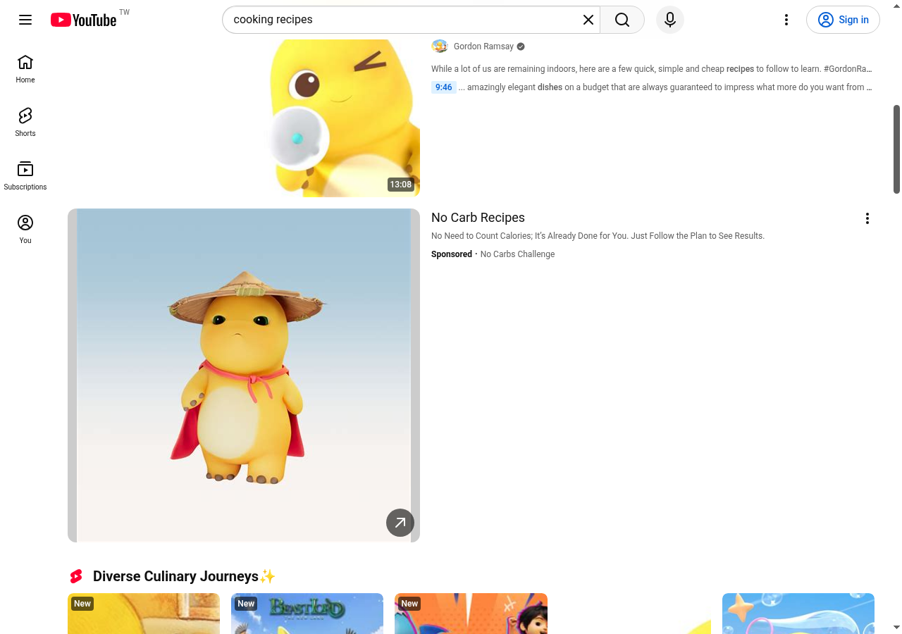

# 奶龍圖片替換（Nailoong Image Swap）

一個 Chrome Manifest V3 擴充功能，會把網站上的圖片換成奶龍圖片。



圖片是執行時用 Bing 圖片搜尋即時抓的，沒有打包圖庫，也沒有寫死的網址清單，所以每次載入頁面看到的圖片都不一樣。

- **預設關閉**：要在工具列的 popup 打開開關才會生效。
- **不打包圖片**：整個擴充功能解壓後約 40 KB，壓縮後約 7.5 KB。
- **不需要帳號、沒有遙測、沒有分析**：唯一的網路請求就是圖片搜尋和下載圖片。
- **授權：GPL-3.0-or-later。**

其他語言：[English](README.md) · [简体中文](README.zh-Hans.md)

---

## 安裝方式

使用者不需要安裝 Node、npm 或任何開發依賴。你需要的是這個專案建置好的 `dist/nailoong-image-swap` 資料夾。

1. 取得這個專案（`git clone`，或從 Releases 下載並解壓縮 ZIP）。

2. 開啟 Chrome、Brave、Edge 或其他 Chromium 瀏覽器的擴充功能頁面：

```text
chrome://extensions
```

Brave 請用 `brave://extensions`，Edge 請用 `edge://extensions`。

3. 打開右上角的「開發人員模式」。

4. 按「載入未封裝項目」。

5. 選擇 `dist/nailoong-image-swap` 資料夾。

6. 點工具列上的「Nailoong Image Swap」圖示，打開「Nailoong images」開關。

7. 重新整理要測試的網站。

> 如果你拿到的是原始碼而不是建置好的 `dist/`，先在專案根目錄執行 `npm install && npm run build`，再載入 `dist/nailoong-image-swap`。

## 使用方式

點工具列圖示會看到一個開關：


打開後，目前和之後載入的頁面都會開始換圖。關掉開關，頁面上的原圖會還原。設定會存在瀏覽器裡，重開瀏覽器仍然有效。

## 運作方式

內容腳本會掃描頁面，替換 `` 元素和 CSS 背景圖片。它自己不做任何網路請求：它向背景 service worker 要一個編號的插槽，由 worker 決定要回傳哪張圖。

worker 會維護一份從 Bing 圖片搜尋來的網址池。池子快用完時，它會隨機挑一個關鍵字和一個結果頁重新填充。所以每次載入頁面都是從不同的結果切片取圖。

圖片會先轉成 `data:` URL 才送到頁面，所以頁面永遠看不到遠端的圖片主機。

## 開發者

```bash
npm install
npm run build
```

建置會把 `src/` 編譯到 `dist/nailoong-image-swap/`，並產生 `dist/nailoong-image-swap.zip`。`dist/` 裡的全部內容都是建置產生的，不要手動修改。改完原始碼後，回到擴充功能頁面按重新載入。

其他指令：

```bash
npm run typecheck   # TypeScript 型別檢查
npm run build:dev   # 保留 localhost 測試開關的開發版建置
```

## 專案結構

```text
src/
  background.ts      service worker：圖片搜尋、抓圖、快取、發放圖片
  content.ts         內容腳本：掃描頁面、換圖、還原
  search-images.ts   Bing 圖片搜尋與結果解析
  messages.ts        內容腳本與 service worker 之間的訊息格式與驗證
  popup.ts           工具列 popup 的開關邏輯
  popup.html/css     popup 介面
  types/chrome.d.ts  用到的 Chrome API 型別宣告
scripts/build.mjs    唯一的建置腳本
manifest.json        擴充功能設定，建置時複製進 dist/
assets/demo/         README 用的截圖
README.md            英文版
README.zh-Hant.md    繁體中文版
README.zh-Hans.md    簡體中文版
```

## 注意

- 圖片來源是 Bing 圖片搜尋的縮圖，解析度不高。放大到滿版時會看得出來。
- service worker 只會抓 Bing 自家 CDN（`ts1`–`ts4.mm.bing.net`）的縮圖，搜尋結果指向其他網域的一律丟掉。
- 每次載入頁面會隨機挑一個搜尋關鍵字和一個結果頁，所以不同網站、不同時間看到的圖片都不一樣。
- 如果某張圖抓不到，worker 會往後找下一張，不會出現破圖。
- 解析 Bing 搜尋端點，不是官方 API。Bing 改版就停止換圖。

## 安全性

內容腳本會在每個頁面上執行，所以它把頁面當成敵對環境。

- 它只會把 `data:image/...` 的值寫回 DOM，而且只限點陣格式。SVG 被排除，因為它可以夾帶腳本。
- 它會拒絕不是來自這個擴充功能的訊息。
- 它從不指定網址。它只要求一個編號插槽，由 worker 決定要抓什麼，所以敵對頁面無法把請求導向自己指定的主機。
- worker 只會抓 Bing 自家 CDN 的縮圖，任何指向其他地方的搜尋結果都會被丟掉。
- localhost 測試開關在正式建置中會被編譯掉，只有 `npm run build:dev` 會保留。

## 權限

| 權限 | 用途 |
| --- | --- |
| `storage` | 記住開關是否打開。 |
| `www.bing.com/images/async` 的 `host_permissions` | 執行圖片搜尋。 |
| `ts1`–`ts4.mm.bing.net` 的 `host_permissions` | 下載縮圖。 |
| `<all_urls>` 上的內容腳本 | 必須看到頁面才能換圖。 |

## 致謝

奶龍（Nailoong）是各自權利人創作的角色。本專案是粉絲自製的玩笑擴充功能，與他們沒有隸屬關係，也未經他們背書。GPL 授權涵蓋這份原始碼，不涵蓋它抓取的圖像。

## 授權

Copyright (C) 2026 taco

This program is free software: you can redistribute it and/or modify it under
the terms of the GNU General Public License as published by the Free Software
Foundation, either version 3 of the License, or (at your option) any later
version.

This program is distributed in the hope that it will be useful, but WITHOUT ANY
WARRANTY; without even the implied warranty of MERCHANTABILITY or FITNESS FOR A
PARTICULAR PURPOSE. See the GNU General Public License for more details.

You should have received a copy of the GNU General Public License along with
this program. If not, see <https://www.gnu.org/licenses/>.
